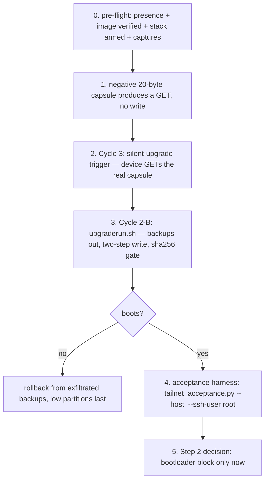

# Flash-day operator runbook — Wyze Cam v4 (T41NQ, 16 MiB NOR)

Status: consolidation, 2026-10-28. This is the single operator document for the day a unit is
flashed; it cites the owning docs instead of restating their evidence. Every gate below is
already dry-run-proven or byte-verified — nothing here is new mechanism. Nothing writes flash
until §4 and the unit is present (arp AND ICMP, `docs/exploit/LEARNINGS.md` §"Host and network
facts").

Sources of truth, in the repo's truth hierarchy:

| Doc | What it owns |
|---|---|
| `docs/exploit/cve-watch-2026-10.md` §"Plan A execution prep" | boot-gate byte proof: INGE table, ROM/SPL/U-Boot verification links, the two-step decision |
| `docs/exploit/flash-plan.md` | the 16 MiB chip layout table, the on-camera `dd` procedure, rollback, brick traps |
| `docs/exploit/FINISH-WYZE.md` | the forged-OTA delivery stack (DNS/TLS/broker), cycle ordering 3→4→5→2, operator decision matrix |
| `docs/exploit/firmware-build.md` | the tailnet image itself: partition-map change, rootfs contents, sha256 pin |
| `docs/exploit/TAILSCALE-ENDSTATE.md` §2 | what "done" means after flash (acceptance contract) |

## 0. Pre-flight (no device writes, 10 minutes)

1. **Presence:** `sudo arp -an | grep "(IP)"` AND one ICMP reply. Eero proxy-answers ICMP for
   asleep devices — arp is the authority (`LEARNINGS.md`). Never poke an absent camera.
2. **Sensor variant (pre-flight, decides the image):** the two images differ in the chip-header
   byte (`0x40` gc4653 / `0x52` os04d10) and kernel+rootfs (246,716 bytes in `0x70000..0x200000`).
   Identify the unit's sensor from the stock descriptor (`get_processes` components or the
   vendor API device info), then verify the chosen image:
   ```sh
   python3 deliverables/scripts/verify_thingino_image.py ~/fss-exploit/fw/thingino_<sensor>.bin
   ```
   Every assertion must print OK (INGE entry 0 secure-boot clear, 2-word terminator shape, env
   crc, base mtdparts). Committed reference output:
   `docs/exploit/verify-thingino-image-2026-10-28.md`. sha256 pins:
   - `ad2906fe…3538` `thingino_gc4653.bin`
   - `e1cc48de…4545` `thingino_os04d10.bin`
3. **Capture before anything:** `cat /proc/mtd`, `cat /sys/class/net/wlan0/address`,
   `fw_printenv` (if present) — `flash-plan.md` §Risks: `provisioning` overwrite may change
   WiFi MAC/RF calibration; these lines plus the six partition backups are the only return
   ticket.
4. **Delivery stack armed and proven:** `./deliverables/scripts/wyze_mitm_up.sh` prints one
   verdict line per listener (`FINISH-WYZE.md` §"Rebuild and prove every listener"). The stack
   must be armed BEFORE the boot, because a boot always reconnects MQTT but a live client never
   re-resolves (`FINISH-WYZE.md` §mechanism). Daemons via launchd (`deliverables/launchd/`), not
   `nohup` (`LEARNINGS.md`).

## 1. The two-step decision (cve-watch §"Flash-order decision package")

Stock OTA never flashes the bootloader (recovery RKAF carries exactly `boot` + `system`,
verified at `0xd4`/`0xec` of the RKAF table). Two-step reduces blast radius:

- **Step 1 — rootfs+kernel via the stock updater shape:** keep `0x0..0x50000` byte-identical
  (already true in the assembled image), write only `0x70000..0xF00000` (kernel + rootfs + env)
  through `upgraderun.sh`. Rollback = re-serve the stock capsule (proven path, Cycle 2A).
- **Step 2 — bootloader block (`0x0..0x50000`, carries the INGE table)** only AFTER step 1 is
  observed booting, with the six backups from step 1 still on the operator host.

The full-chip one-shot in `upgraderun.sh` remains valid (bootloader written last) — the two-step
is the review alternative. Either way: backups exfiltrated before the first write, sha256 gate on
the image, geometry refusal on `/proc/mtd` mismatch (all in the script, dry-run-proven
`FINISH-WYZE.md` §12:17).

## 2. What is proven vs what the flash itself settles (cve-watch §2–§3)

| Link | State |
|---|---|
| cloud delta / HTTPS GET / tar extract / `sh upgraderun.sh` as root | PROVEN (six fetches 2026-10-25; `ota-path.md` §12) |
| backups, sha256 gate, geometry check, write order | PROVEN as mechanics (dry run) |
| our six-partition absolute-offset write on real mtdblock | NOT YET RUN — flash day settles it |
| ROM acceptance of this exact init table on a production v4 | NOT YET OBSERVED — flash day settles it |
| thingino U-Boot booting unsigned kernel+rootfs | BYTE-SUPPORTED (no FIT-sig code in the decompressed binary) — first boot pending |

## 3. Gate order on the day (each gates the next; a failed gate costs nothing)



The negative capsule gate (`FINISH-WYZE.md` §Pre-flight) is non-negotiable: `4.52.17.30.tar`
must be 20 bytes, md5 `6909e9ca…`, and must produce a device GET before any real capsule is
served. A stale capsule under the negative name has already happened once.

## 4. Write procedure

On-camera: `flash-plan.md` §Procedure verbatim (`set -e`, tool check, `/proc/mtd` geometry
table built host-side from the live map, per-partition backup + hash, exfiltrate over `nc`,
fetch + sha256 the image, write high-offset-first with the bootloader LAST, `sync; reboot`).
Do not interrupt a running `dd`.

## 5. Acceptance after first boot (`TAILSCALE-ENDSTATE.md` §2)

```sh
python3 deliverables/scripts/tailnet_acceptance.py --host <cam>.<tailnet>.ts.net \
    --expect-model wyze_cam4 --ssh-user root
```

Eight rows: rtsp-port, rtsp-handshake (DESCRIBE/SETUP/PLAY), rtsp-frame (real ffmpeg decode —
the prudynt stream), onvif-capabilities, onvif-device-info (Manufacturer/Model/FirmwareVersion —
the flashed-image identity gate; `--expect-model` makes it an assertion), http-control,
tailscaled-status (`tailscale status` over dropbear SSH, node + peers), tailnet-bind.
Self-tested against mocks: `python3 tests/test_tailnet_acceptance.py` (20 asserts).

Done = all eight rows pass from a tailnet member with no LAN presence, plus the FSS ingest row
(`fss-9tdk4`) landing frames in the pipeline over the tailnet.

## 6. Failure playbook

| Symptom | Action |
|---|---|
| no GET on the negative capsule | power-cycle with the stack armed; check `/tmp/dns.log`, broker log; `FINISH-WYZE.md` §state table |
| boots without network | wrong sensor slice — rebuild with the other variant, re-serve capsule (`flash-plan.md` §Risks) |
| wedged after write | restore from the exfiltrated `bk*.bin`, low partitions last, then reboot (`flash-plan.md` §Rollback) |
| power loss during `mtdblock0/1` write | TFTP/USB + UART only — outside the wire-only constraint; this is why the two-step exists |
| MQTT client dead after one interaction | expected (`FLEET_LIBERATION_STATUS.md` §Resumption): physical power cycle is the single reviver |
